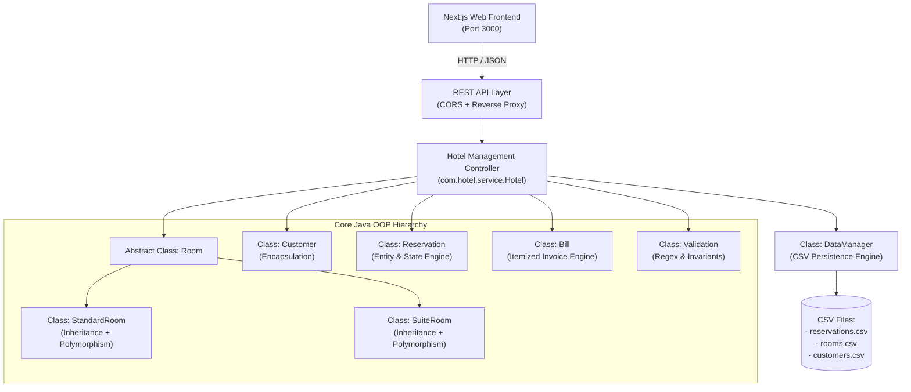

# 🏨 Hotel Reservation System (Java OOP Backend + Next.js Frontend)

> **Academic Project Implementation**  
> **Course:** Object-Oriented Programming Using Java  
> **Group Members:**
> 1. **Adhwaith AS** (Roll No: 5)
> 2. **Arjun B** (Roll No: 16)
> 3. **Martin Job** (Roll No: 35)
> 4. **Naveen S** (Roll No: 38)

---

## 📋 Project Summary

This project implements a full-featured **Hotel Reservation Management System** built with a **Core Java 21 Object-Oriented Backend** and a modern, high-performance **Next.js** web interface. Data is persistently retained using **CSV file-based storage**, strictly adhering to the requirements outlined in the project proposal report.

---

## 🏛️ System Architecture



---

## 🎯 Object-Oriented Programming (OOP) Concepts (Report Section 9)

| OOP Concept | Implementation in Codebase | Reference File |
| :--- | :--- | :--- |
| **9.1 Encapsulation** | All entity fields (`Customer`, `Reservation`, `Room`) are marked `private`. Mutations pass through validated getters, setters, and calculation methods. | [`Customer.java`](file:///home/adhwaithas/JAVA/MAAN/backend/src/com/hotel/model/Customer.java) |
| **9.2 Inheritance** | [`StandardRoom`](file:///home/adhwaithas/JAVA/MAAN/backend/src/com/hotel/model/StandardRoom.java) and [`SuiteRoom`](file:///home/adhwaithas/JAVA/MAAN/backend/src/com/hotel/model/SuiteRoom.java) extend the abstract base class [`Room`](file:///home/adhwaithas/JAVA/MAAN/backend/src/com/hotel/model/Room.java), inheriting common properties (`roomNumber`, `basePricePerNight`, `capacity`, `isAvailable`). | [`Room.java`](file:///home/adhwaithas/JAVA/MAAN/backend/src/com/hotel/model/Room.java) |
| **9.3 Polymorphism** | Subclasses provide distinct implementations for `calculateTotalRate(nights)`, `getTaxRate()`, `getDefaultAmenities()`, and `getRoomCategoryDescription()`. | [`StandardRoom.java`](file:///home/adhwaithas/JAVA/MAAN/backend/src/com/hotel/model/StandardRoom.java)<br>[`SuiteRoom.java`](file:///home/adhwaithas/JAVA/MAAN/backend/src/com/hotel/model/SuiteRoom.java) |
| **9.4 Abstraction** | The abstract class [`Room`](file:///home/adhwaithas/JAVA/MAAN/backend/src/com/hotel/model/Room.java) defines abstract contract signatures, separating rate calculation and categorization details from the hotel service. | [`Room.java`](file:///home/adhwaithas/JAVA/MAAN/backend/src/com/hotel/model/Room.java) |
| **9.5 Classes & Objects** | Real-world entities (`Customer`, `Room`, `Reservation`, `Bill`) are instantiated as runtime objects interacting within [`Hotel`](file:///home/adhwaithas/JAVA/MAAN/backend/src/com/hotel/service/Hotel.java). | [`Hotel.java`](file:///home/adhwaithas/JAVA/MAAN/backend/src/com/hotel/service/Hotel.java) |
| **9.6 Exception Handling** | Custom exception hierarchy ([`HotelException`](file:///home/adhwaithas/JAVA/MAAN/backend/src/com/hotel/exception/HotelException.java), [`ValidationException`](file:///home/adhwaithas/JAVA/MAAN/backend/src/com/hotel/exception/ValidationException.java), [`RoomNotAvailableException`](file:///home/adhwaithas/JAVA/MAAN/backend/src/com/hotel/exception/RoomNotAvailableException.java), [`ReservationNotFoundException`](file:///home/adhwaithas/JAVA/MAAN/backend/src/com/hotel/exception/ReservationNotFoundException.java)) provides robust error boundaries with HTTP error codes. | [`exception/`](file:///home/adhwaithas/JAVA/MAAN/backend/src/com/hotel/exception/) |

---

## 🗂️ Proposed Class Structure (Report Section 8)

| Class | Purpose & Responsibility |
| :--- | :--- |
| **`Customer`** | Stores customer information: `id`, `name`, `email`, `phone`. |
| **`Room`** | Abstract base class containing common room attributes and contract methods. |
| **`StandardRoom`** | Standard Room subclass (Queen bed, $110/night, 10% tax rate). |
| **`SuiteRoom`** | Luxury Suite subclass (King bed, Jacuzzi, Balcony, $240/night + $25 luxury surcharge, 14% tax rate). |
| **`Reservation`** | Stores `reservationId`, customer, room, dates, and tracks lifecycle status (`BOOKED`, `CHECKED_IN`, `CHECKED_OUT`, `CANCELLED`). |
| **`Bill`** | Computes itemized charges, taxes, and generates formatted ASCII & digital invoices. |
| **`Hotel`** | Central manager handling availability checks, bookings, check-in/out, cancellations, and statistics. |
| **`DataManager`** | Persistently saves and loads data to/from CSV files (`reservations.csv`, `rooms.csv`, `customers.csv`). |
| **`Validation`** | Provides regex and logical validation for email, phone numbers, and chronological date sequences. |

---

## 🚀 Key Features Implemented (Report Section 4 & 6)

1. **Room Booking (4.1):** Book Standard or Suite rooms by entering guest details, room selection, and stay dates with live availability checks.
2. **Unique Reservation ID (4.2):** Automatic generation of unique IDs (`RES-1001`, `RES-1002`, etc.).
3. **Customer Information (4.3):** Full customer profile tracking (name, email, phone number, stay history).
4. **Check-in and Check-out (4.4):** Dedicated operations to check guests in and out, dynamically updating room vacancy and payment status (`DUE` ➔ `PAID`).
5. **Automatic Bill Generation (4.5):** Itemized calculation based on room type, nights, tax rate, and luxury packages with formatted ASCII invoice generation.
6. **Input Validation (4.6):** Strict client and server validation for email format, phone format, and date ordering.
7. **View & Search Reservations (4.7):** Real-time search across guest names, reservation IDs, emails, and rooms, with status and room type filters.
8. **Update & Delete Reservations (4.8):** Edit reservation details; deletion requires explicit user confirmation modal to prevent accidental data loss.
9. **Data Persistence (4.9):** Atomic CSV read/write operations retain data across sessions.
10. **Executive Dashboard:** Live metrics for Occupancy Rate, Total Revenue, Vacant Rooms, and Today's Check-ins.

---

## 📡 REST API Endpoints

| Method | Endpoint | Description |
| :--- | :--- | :--- |
| `GET` | `/api/health` | Backend status check |
| `GET` | `/api/stats` | Occupancy, revenue, and inventory statistics |
| `GET` | `/api/rooms` | List all hotel rooms and their occupancy |
| `GET` | `/api/rooms/available?checkIn=...&checkOut=...&type=...` | Query vacant rooms for date range |
| `GET` | `/api/reservations?q=...&status=...&roomType=...` | List and filter reservations |
| `GET` | `/api/reservations/{id}` | Single reservation details |
| `POST` | `/api/reservations` | Create a new room reservation |
| `PUT` | `/api/reservations/{id}` | Update reservation details |
| `DELETE` | `/api/reservations/{id}` | Delete reservation from CSV |
| `POST` | `/api/reservations/{id}/checkin` | Check in guest |
| `POST` | `/api/reservations/{id}/checkout` | Check out guest |
| `POST` | `/api/reservations/{id}/cancel` | Cancel reservation |
| `GET` | `/api/reservations/{id}/bill` | Generate itemized bill & formatted receipt |

---

## 🛠️ How to Run the Application

### Option 1: Start Everything with One Command
```bash
./start-all.sh
```
This compiles the Java backend, starts it on `http://localhost:8080`, and launches the Next.js web application on `http://localhost:3000`.

### Option 2: Run Separately

#### Run Java Backend:
```bash
./backend/run.sh
```
*(Runs on port 8080 with zero external Maven/Gradle dependencies using Java 21 standard library)*

#### Run Next.js Frontend:
```bash
./frontend/run.sh
```
*(Runs on port 3000, proxies API calls to port 8080)*

Access the application in your browser at: **`http://localhost:3000`**
