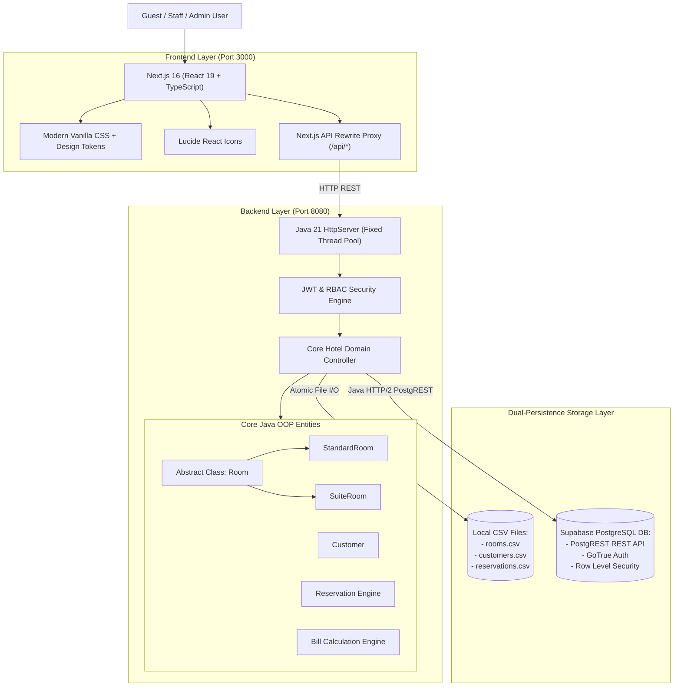

# 🛠️ Tech Stack & Architecture Specification

> **Project:** Hotel Reservation Management System ("The Oasis")  
> **Authors:** Adhwaith AS (Roll No: 5), Arjun B (Roll No: 16), Martin Job (Roll No: 35), Naveen S (Roll No: 38)  
> **Course:** Object-Oriented Programming Using Java

---

## 📑 Table of Contents
1. [Overview](#-overview)
2. [Frontend Stack](#-frontend-stack)
3. [Backend Stack](#-backend-stack)
4. [Database & Persistence Stack](#-database--persistence-stack)
5. [Authentication & Security](#-authentication--security)
6. [Object-Oriented Programming (OOP) Implementation](#-object-oriented-programming-oop-implementation)
7. [DevOps, Tooling & Scripts](#-devops-tooling--scripts)
8. [System Architecture Diagram](#-system-architecture-diagram)
9. [Summary Checklist](#-summary-checklist)

---

## 🌟 Overview

The **Hotel Reservation Management System** is a full-stack, enterprise-grade application combining a **zero-dependency Core Java 21 backend** and a modern **Next.js 16 (React 19) frontend**. The architecture demonstrates production-level Object-Oriented Design principles while integrating modern cloud capabilities (Supabase PostgreSQL & Auth) alongside strict flat-file CSV persistence.

---

## 💻 Frontend Stack

| Technology / Tool | Version | Category | Purpose & Implementation Details |
| :--- | :--- | :--- | :--- |
| **Next.js** | `16.3.0` | Frontend Framework | App Router (`src/app`), server-side rewrites for API proxying, responsive routing. |
| **React** | `19.2.8` | UI Library | Component-based stateful architecture, hooks (`useState`, `useEffect`, `useCallback`). |
| **TypeScript** | `^5.0.0` | Programming Language | Strict type definitions (`types.ts`), end-to-end interface contracts with backend DTOs. |
| **Modern Vanilla CSS** | CSS3 | Styling & Theming | Custom design tokens, glassmorphism, soft lighting shadows, responsive flexbox & grid. |
| **Lucide React** | `^1.30.0` | Iconography | High-quality icons for UI navigation, badges, actions, and system status indicators. |
| **Google Fonts** | Web Fonts | Typography | Curated typography pairing: `Plus Jakarta Sans` (UI body), `Outfit` (headings), and `JetBrains Mono` (invoices & IDs). |
| **Next.js Rewrites Proxy** | Built-in | Network Layer | Proxies `/api/*` to the Java backend (`http://localhost:8080`), eliminating browser CORS errors. |

### Key Frontend Components & Features
- **Executive Dashboard** (`DashboardStats.tsx`): Displays real-time Occupancy Rate, Total Revenue, Available Rooms, and Today's Check-ins.
- **Interactive Reservations Engine** (`ReservationsTable.tsx`): Real-time search, status filtering, check-in, check-out, and cancellation workflows.
- **Room Showcase & Inventory Grid** (`RoomInventory.tsx`): Dynamic visual display of Standard & Suite rooms, live vacancy badges, and one-click booking.
- **Itemized Billing & Invoice Modal** (`BillModal.tsx`): Detailed rate calculation, luxury surcharges, tax computation, and ASCII printable receipt viewer.
- **Role-Based Views**: Tailored interface experiences for `ADMIN`, `STAFF`, and `GUEST` users.
- **Interactive OOP Architecture Viewer** (`OopArchitecture.tsx`): Visual explanation of underlying Java OOP classes for academic presentation.
- **Audit Logs Explorer** (`AuditLogsTable.tsx`): Real-time view of backend security and operational events.

---

## ☕ Backend Stack

| Technology / Tool | Version | Category | Purpose & Implementation Details |
| :--- | :--- | :--- | :--- |
| **Java** | `21 (LTS)` | Backend Runtime | Core Java standard library (Eclipse Temurin JDK 21). Developed with zero external Maven/Gradle libraries. |
| **Embedded HTTP Server** | `com.sun.net.httpserver` | HTTP Web Server | Native Java HTTP REST API engine running on port `8080`. |
| **Java Concurrency** | `java.util.concurrent` | Thread Management | Multithreaded execution using `Executors.newFixedThreadPool(16)` with thread-safe collections (`ConcurrentHashMap`, `Collections.synchronizedList`). |
| **Java HTTP/2 Client** | `java.net.http.HttpClient` | Network Client | Native non-blocking HTTP/2 client for connecting to cloud Supabase PostgREST endpoints. |
| **Custom JSON Engine** | Handcrafted | Serialization | Reflection-free, lightweight JSON parsing and serialization utility (`JsonUtils.java`). |
| **Enterprise Logger** | Custom | Observability | Multi-level logging framework (`AppLogger.java`) supporting console output and persistent file logging (`logs/hotel-server.log`). |
| **Regex Validator** | `java.util.regex` | Data Integrity | Rigorous validation for email RFC patterns, international phone numbers, and date chronology (`Validation.java`). |
| **Environment Loader** | Custom | Configuration | Custom `.env` file parser (`EnvConfig.java`) for zero-dependency secret and port injection. |

---

## 🗄️ Database & Persistence Stack

The system implements a **Dual-Layer Persistence Strategy**:

### 1. Supabase PostgreSQL (Cloud Database)
- **Engine:** PostgreSQL 15+ hosted on Supabase.
- **Data Access:** PostgREST RESTful API accessed via native Java `HttpClient`.
- **Database Schema (`supabase-schema.sql`):**
  - `rooms`: Room inventory, pricing, capacities, tax rates, amenities arrays.
  - `customers`: Guest demographic profiles, contact details, stay histories.
  - `reservations`: Booking dates, lifecycle state machine, total charge calculation.
  - `user_profiles`: User roles (`ADMIN`, `STAFF`, `GUEST`) linked to Supabase Auth.
  - `audit_logs`: Detailed system access, reservation changes, and administrative actions.
- **Advanced DB Features:**
  - Database Triggers (`on_auth_user_created` trigger for automatic profile generation).
  - Row Level Security (RLS) policies for multi-tenant isolation and role segregation.
  - PostgreSQL Extensions: `uuid-ossp`, `pgcrypto`.

### 2. Local CSV Persistence Engine (Academic & Fallback)
- **Engine:** Flat-file atomic read/write storage engine (`DataManager.java`).
- **Files:**
  - `data/rooms.csv`: Room types, base rates, amenities, and availability flags.
  - `data/customers.csv`: Customer IDs, names, emails, and contact numbers.
  - `data/reservations.csv`: Complete booking records, check-in/out timestamps, and financial totals.
- **Purpose:** Guarantees full offline functionality, meeting the strict CSV project specification.

---

## 🔐 Authentication & Security

- **Supabase GoTrue Auth:** Secure sign-up, sign-in, and password hashing using industry-standard bcrypt/scrypt.
- **JSON Web Tokens (JWT):** Bearer token authentication verified on every protected API call via `AuthContext.java`.
- **Role-Based Access Control (RBAC):**
  - **`ADMIN`**: Full permissions including user creation, staff provisioning, price changes, and audit log inspection.
  - **`STAFF`**: Check-in, check-out, bill generation, and reservation modifications.
  - **`GUEST`**: Room discovery, availability lookups, personal booking creation, and invoice inspection.
- **Input Sanitization & Invariants:**
  - Date chronology checks (`check_out_date > check_in_date`).
  - Double-booking prevention with overlapping reservation collision detection.
  - Strict regex checks on email addresses and telephone numbers.

---

## 🧩 Object-Oriented Programming (OOP) Implementation

| OOP Pillar | Codebase Implementation | Key Classes / Files |
| :--- | :--- | :--- |
| **Encapsulation** | Private field access, defensive copying, validated getters/setters, state mutators. | [`Customer.java`](file:///home/adhwaithas/JAVA/MAAN/backend/src/com/hotel/model/Customer.java), [`Reservation.java`](file:///home/adhwaithas/JAVA/MAAN/backend/src/com/hotel/model/Reservation.java) |
| **Inheritance** | Hierarchical design where `StandardRoom` and `SuiteRoom` derive from abstract base `Room`. | [`Room.java`](file:///home/adhwaithas/JAVA/MAAN/backend/src/com/hotel/model/Room.java), [`StandardRoom.java`](file:///home/adhwaithas/JAVA/MAAN/backend/src/com/hotel/model/StandardRoom.java), [`SuiteRoom.java`](file:///home/adhwaithas/JAVA/MAAN/backend/src/com/hotel/model/SuiteRoom.java) |
| **Polymorphism** | Dynamic rate calculation (`calculateTotalRate(nights)`), variable tax rates, and luxury surcharges overridden per subclass. | [`Room.java`](file:///home/adhwaithas/JAVA/MAAN/backend/src/com/hotel/model/Room.java) subclasses |
| **Abstraction** | Contract enforcement separating service business logic from specific room behaviors. | [`Room.java`](file:///home/adhwaithas/JAVA/MAAN/backend/src/com/hotel/model/Room.java), [`Hotel.java`](file:///home/adhwaithas/JAVA/MAAN/backend/src/com/hotel/service/Hotel.java) |
| **Custom Exceptions** | Structured hierarchical application error handling returning appropriate HTTP status codes. | [`HotelException.java`](file:///home/adhwaithas/JAVA/MAAN/backend/src/com/hotel/exception/HotelException.java), [`RoomNotAvailableException.java`](file:///home/adhwaithas/JAVA/MAAN/backend/src/com/hotel/exception/RoomNotAvailableException.java) |

---

## 🚀 DevOps, Tooling & Scripts

- **Containerization:** `backend/Dockerfile` using lightweight Alpine Linux with Eclipse Temurin JDK 21 (`eclipse-temurin:21-jdk-alpine`).
- **Cloud Deployment Compatibility:** Configured for one-click deployment to Railway / Render / Fly.io with dynamic `$PORT` detection.
- **Automated Startup Scripts:**
  - [`start-all.sh`](file:///home/adhwaithas/JAVA/MAAN/start-all.sh): Single command that builds and boots both backend and frontend concurrently with trap signals (`SIGINT`, `SIGTERM`, `EXIT`).
  - [`backend/run.sh`](file:///home/adhwaithas/JAVA/MAAN/backend/run.sh): Compiles pure Java source files (`javac -d bin`) and launches server on port 8080.
  - [`frontend/run.sh`](file:///home/adhwaithas/JAVA/MAAN/frontend/run.sh): Starts the Next.js development server on port 3000.
- **Configuration Management:** `.env` and `.env.example` templates for seamless environment reproducibility.

---

## 🏛️ System Architecture Diagram

---

## 📋 Summary Checklist

| Layer | Primary Technology | Key Highlights |
| :--- | :--- | :--- |
| **Frontend** | Next.js 16, React 19, TypeScript | Zero CSS frameworks, pure design tokens, Lucide icons, responsive layout |
| **Backend** | Java 21 (Temurin JDK 21) | Zero external build dependencies, embedded HTTP server, multithreaded |
| **Database** | PostgreSQL (Supabase) + CSV Files | Dual-persistence engine, ACID compliance, offline fallback support |
| **Security** | Supabase Auth + JWT + RBAC | Role-based permission enforcement for Admin, Staff, and Guest |
| **Design Pattern** | OOP + MVC + Factory/Strategy | Full implementation of Encapsulation, Inheritance, Polymorphism, Abstraction |
| **Deployment** | Docker & Bash Orchestration | Multi-stage Dockerfile, automated build scripts (`start-all.sh`) |
